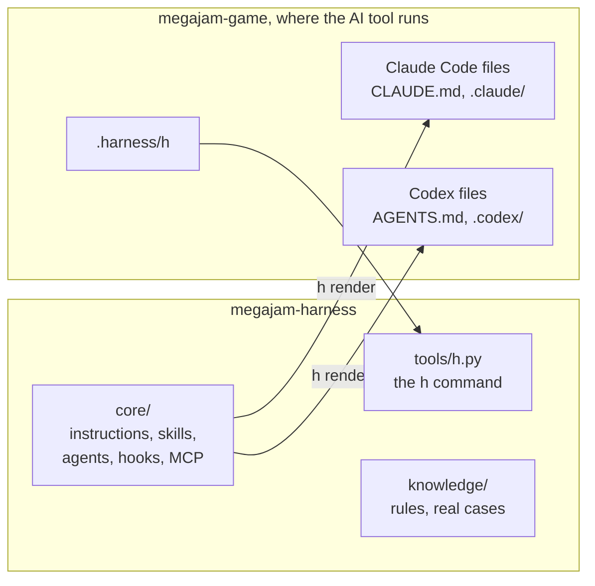
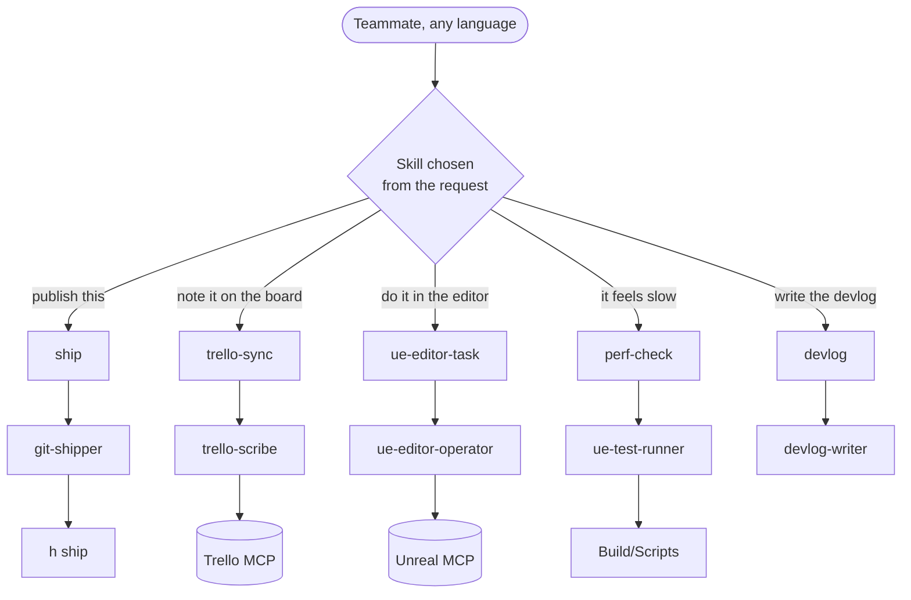
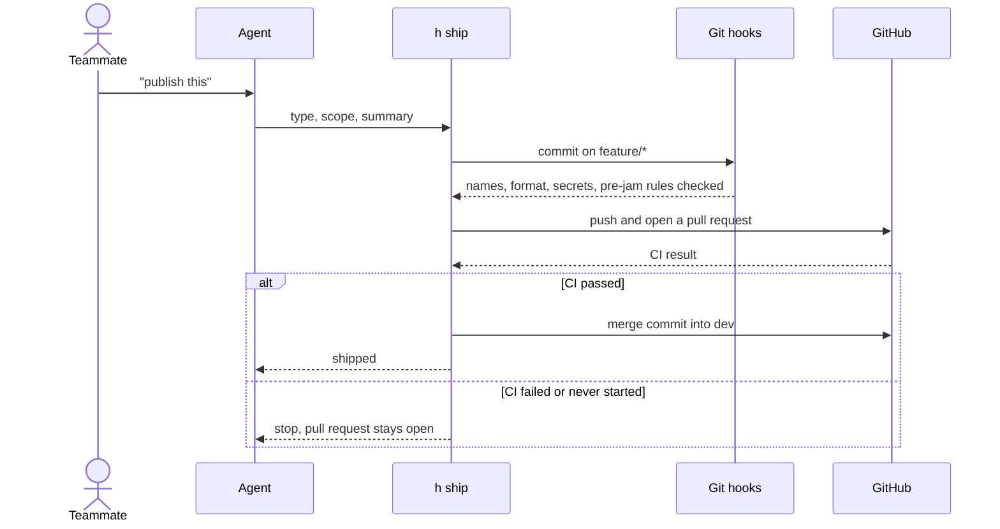
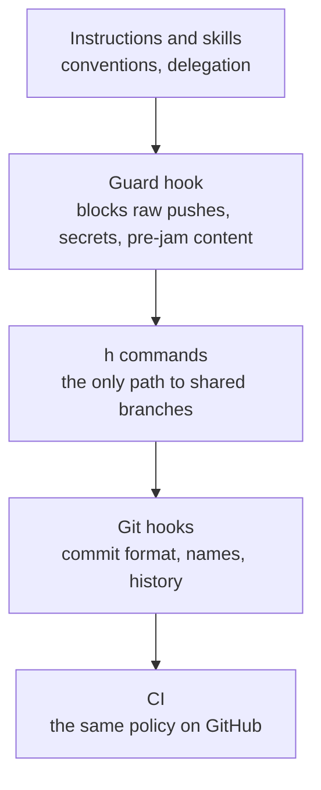
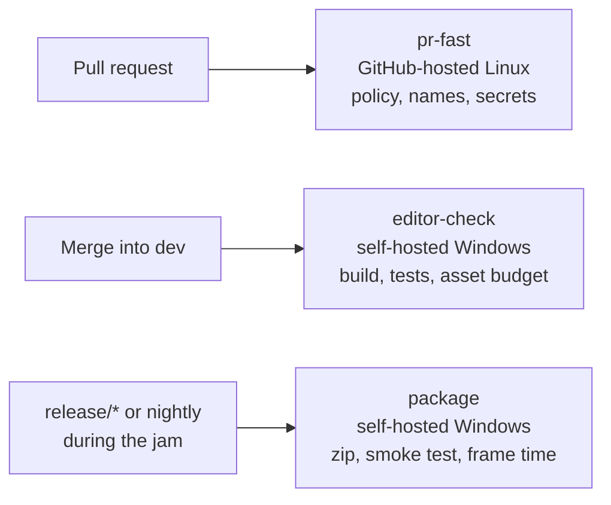

# megajam-harness

A vendor-neutral multi-agent harness for making an Unreal Engine game in four days, built for the 2026 Epic AI MegaJam.

One definition of skills, subagents, hooks and MCP servers generates the configuration for either Claude Code or Codex. Anyone on the team can contribute in plain language, including people who do not program.

## Install

1. Clone this repository to `C:\Repos\MegaJam\megajam-harness`.
2. Open the folder in Claude Code or Codex.
3. Say: **"Install the harness."**

The agent clones the game next to it, generates the files for your tool and runs the doctor.

## How it fits together

Generated files never enter git, so each teammate gets the output for their own tool and paths. See [docs/architecture.md](docs/architecture.md).

## How a request travels

Every request goes to a skill, which hands the work to a subagent with only the tools it needs. Writes to shared branches leave through one command, `h ship`.

## Examples from our setup

These are requests from our preparation for the jam, some typed by us and some from the eval cases that guard each skill, with what happened.

### Publish work without knowing git

> "ya termine el modelo del barril, subilo al repo y avisale al equipo" (Spanish for "I finished the barrel model, push it to the repo and tell the team")

That is the eval case `ship-spanish-artist`, which runs before any change to the skill can merge. The `ship` skill runs `h ship`, which does the whole path below. The artist on the team never types a git command.

A real case: our first pull request merged before CI had even started, because Actions was not truly enabled on the new repository. `h ship` now stops with `checks-missing` and leaves the pull request open. The lesson is in [knowledge/cases/ci-actions-not-running.md](knowledge/cases/ci-actions-not-running.md).

### Keep the board up to date

> "creá una tarjeta para que los tres instalemos el plugin de Blender" (Spanish for "make a card for the three of us to install the Blender plugin"), from the eval case `trello-each-member`

`trello-scribe` writes the card with three sections, `Need`, `Goal` and `Steps`, adds an `Each member` checklist with one item per teammate, and labels it by category. The connector cannot add people to a card, so the agent names who to add instead of claiming it did. See [knowledge/cases/trello-connector-limits.md](knowledge/cases/trello-connector-limits.md).

### Build something in the editor

> "probá el MCP creando un pj que salte", then "ponele controles de movimiento con WASD y mover la cámara con el mouse" (Spanish for "test the MCP by making a character that jumps", then "add WASD movement and mouse camera control")

In a throwaway project, `ue-editor-operator` built a Character Blueprint through Unreal MCP alone: a jump on the space bar, a spring arm camera that orbits with the mouse, and movement relative to the camera. It compiled, ran in Play In Editor and a person confirmed the controls.

It also found limits that are now written into the agent, for example:

- The Blueprint DSL accepts only `event` or `fn` at the top level, so key events are wired node by node.
- A positional argument goes into the `self` pin, so arguments are passed by name.
- Some node names match two types. One picked the wrong class and the Blueprint did not compile until the agent found the unconnected pin.

See [knowledge/cases/unreal-mcp-first-build.md](knowledge/cases/unreal-mcp-first-build.md).

### Check performance

> "el juego anda a tirones, fijate si llega a 60 fps en 1080p" (Spanish for "the game stutters, check whether it reaches 60 fps at 1080p"), from the eval case `perf-check-slow-game`

`perf-check` runs two scripts from the game repository and explains the result: which resolution failed, and whether the game thread, the render thread or the GPU is the slowest. The same checks run in CI and draw tables and charts in the workflow summary.

| Check | What it measures | Blank project result |
| --- | --- | --- |
| Frame time | p95 at 720p, 1080p and 1440p in the packaged build | 1080p: 2.8 ms p95, 17% of the 16.67 ms budget |
| Asset budget | Texture size, triangles, LODs, base materials, Blueprints that tick | No content yet, so nothing to flag |

Before trusting the asset check, we ran it on engine content. It flagged 16K and 4K textures as errors and base materials as warnings, as designed.

### Write the devlog

> "cerramos el dia, escribamos la entrada del devlog" (Spanish for "we're done for the day, let's write the devlog entry"), from the eval case `devlog-end-of-day`

The agent asks one teammate for a personal comment, in any language. It translates it to English and edits only what a public page needs, such as profanity. The author approves the final text before it is published. The rest of the entry is a narrative of what changed. See the [first entry](devlog/entries/2026-11-08-the-rules-changed-our-plan.md).

### Improve the harness itself

> "actualizá el harness" (Spanish for "update the harness"), right after the editor test above

The agent wrote what it learned into `ue-editor-operator` and a knowledge case. `h contribute` validates `core/`, runs the unit tests and the behavioral evals for whatever changed, then ships it like any other work. A change to the Trello and devlog formats ran four evals for about USD 0.03 before it could merge. Lessons from real failures go into [knowledge/cases/](knowledge/cases/README.md), so the next session starts with them.

## Layers of control

Instructions can be ignored by a model. Rules that must always hold live in layers that cost no tokens and cannot be skipped.

## Continuous integration in the game repository

The self-hosted runner is a teammate's PC, because GitHub-hosted runners have no Unreal Engine and too little disk.

## Read more

- [Devlog](devlog/README.md): how the game is being made.
- [Documentation](docs/README.md): how the harness works.
- [Skill and agent catalog](docs/catalog.md).
- [Jam rules digest](knowledge/contest/rules-digest.md).
